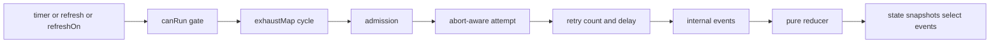

# Architecture

The library maintains one in-memory `QueryState` per query. RxJS owns scheduling, the refresh cycle, retries, and the public streams. There is no second snapshot cache, no execution-engine port, and no storage port. A query starts when it is created. Persistence is a consumer integration: restore into `initialSnapshot`, then follow `snapshots$`.

The consistency boundary is one canonical key within one client. Provider admission spans queries because concurrency and pacing are shared. Limits do not cross processes or tabs.

## Pipeline

`canRun` is `!paused && !blocked`. The interval, `refresh()`, and optional `refreshOn$` share one trigger merge. `exhaustMap` covers the whole cycle, including admission and backoff, so a busy emission is skipped with reason `busy`. An emission while `canRun` is false is dropped with reason `cannotRun`. `refresh()` returns whether it delivered a trigger. From inside a notification it returns `false` and runs after that notification. Neither case is queued, and a busy cycle does not schedule a trailing run.

`src/domain/state.ts` is the only transition authority. Attempt, admission, and gate code emit events. The reducer returns the next `QueryState` and keeps that object. An event the current phase cannot accept throws `IllegalTransitionError`. That error is a defect in this library and is not stored on `state.error`. `workCancelled` while `idle` stays a no-op, because pause between ticks always emits it. `paused` and `blocked` are legal in every live phase. `state()`, `state$`, and `snapshots$` deliver copies of the envelope and of `{ data, receivedAt }`. Mutating a delivered object does not change the next transition. Payload data is not cloned. `state$` replays the current state and then each change. The internal subject is not part of the public API. The first delivery to a subscriber runs inside the same reentrancy guard as later deliveries, so `pause`, `resume`, `refresh`, and `dispose` from that callback are deferred until the notification finishes. Pause unsubscribes only the execution stream. An internal subscription to the external gate and to `refreshOn$` stays alive across pause and resume. Dispose is the only path that sets `disposed: true` and completes `state$`, `snapshots$`, and `events$`.

`snapshots$` is a one-value replay of the latest accepted snapshot. `events$` does not replay. `select` is a new projection each call: map, `distinctUntilChanged`, and a refcounted replay of that view only.

## Modules

| Module                     | Role                                                                                    |
| -------------------------- | --------------------------------------------------------------------------------------- |
| `src/domain/identity.ts`   | `QueryKey` and `keyId`                                                                  |
| `src/domain/state.ts`      | `QueryState`, `Transition`, `reduce`, `IllegalTransitionError`                          |
| `src/domain/event.ts`      | `QueryEvent`, the facts published on `events$`                                          |
| `src/domain/duration.ts`   | Millisecond bounds                                                                      |
| `src/domain/retry.ts`      | Retry policy, backoff, `decideFailure`                                                  |
| `src/domain/policy.ts`     | `resolveInterval` and `resolvePolicy`                                                   |
| `src/domain/admission.ts`  | Provider limits, admission errors, `eligibility`                                        |
| `src/domain/attempt.ts`    | `QueryFn`, attempt errors, cancellation                                                 |
| `src/runtime/admission.ts` | Queue, permits, pacing, and cooldown                                                    |
| `src/runtime/attempt.ts`   | One `queryFn` invocation as an Observable, with a scheduler timeout and an abort signal |
| `src/app/publish.ts`       | Copy on deliver, and defer control methods during a notification                        |
| `src/app/cycle.ts`         | One refresh: admission, attempt, classification, retry                                  |
| `src/app/query.ts`         | `createQuery`, triggers, gate, pause, and dispose                                       |
| `src/app/client.ts`        | Defaults, key registry, `get`, `cooldown`, group dispose                                |
| `src/index.ts`             | Explicit named exports                                                                  |

`src/index.ts` is the only package entry. It lists each export by name. There is no `export *` barrel, and there are no `./core` or `./adapters` entries.

## Admission

The coordinator is not a concurrency operator. A rate-limit operator or a `mergeMap` limit would not keep a bounded queue or release a permit when the promise settles.

A ticket is granted only when client capacity, provider capacity, per-key exclusion, and the provider not-before time all allow it. The scan is FIFO among eligible tickets, so a provider-blocked or same-key-blocked ticket does not block another provider. A ready ticket is granted without taking a queue slot when no earlier queued ticket is ready, including when ineligible tickets already fill the cap. It does not jump an earlier ready ticket; at the cap that newcomer overflows instead. `minIntervalMs` and `cooldown` share one not-before timestamp per provider. Cooldown only extends it. The queue length is capped. Abort, timeout, and close drop the ticket and do not hold a permit that was never granted. An empty queue cancels the pacing wake timer. The provider not-before time remains, so a later query still waits for `minIntervalMs` or cooldown.

The permit is released in the source promise's `finally`. Unsubscribing the attempt aborts its signal and does not release the permit. A timed-out invocation therefore still occupies the key, and the client and provider slots, until the promise settles. The next cycle waits in admission under `admissionTimeoutMs` instead of overlapping that key. A promise that never settles keeps the slot. That is visible as later cycles failing admission, not as a second in-flight call.

Standalone `createQuery` uses the same query function with a private admission object: one key, one running attempt, one queued waiter. It has no registry.

## Time

`now` stamps `receivedAt`. It defaults to `Date.now`. `elapsed` is the monotonic clock for pacing and cooldown, defaulting to `performance.now`. The RxJS scheduler drives interval, backoff, attempt timeout, and admission timeout. Tests inject all three. They are not a consumer configuration guide, and there is no public clock type.

The library `tsconfig` sets `"types": []` and does not include Node types. Browser consumers compile against `dist` with DOM and ES2023.

## What was removed

TanStack no longer executes queries. The engine factory, lifecycle class, snapshot writer, memory store, serialized store, JSON codec, system clock, and RxJS observation adapter are gone. So are `start()`, `params`, persistence status, and `RateLimitError`. A 429 is the caller's to parse; `client.cooldown` records the delay.

## Deferred

Adaptive intervals, reactive query parameters, and a trailing refresh after a busy cycle are intentionally absent. In-flight work is not switched on every tick. There is no combined-query type.
